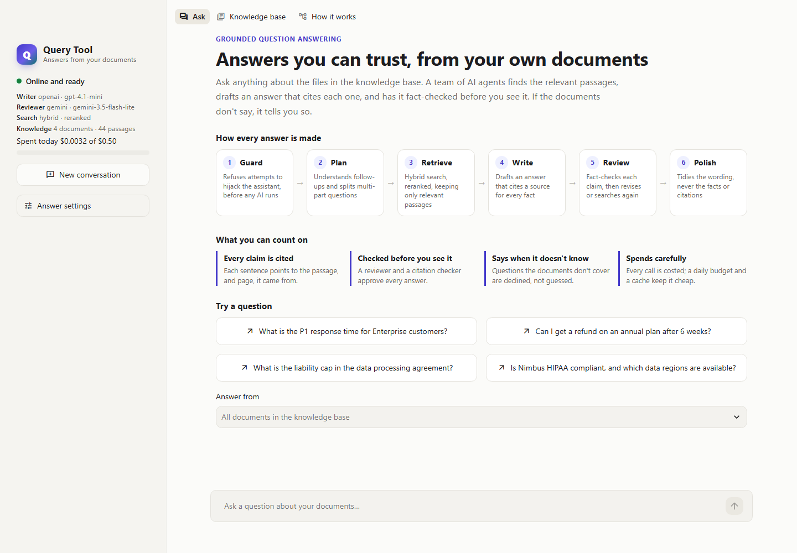

# Query Tool

**Grounded answers from your own documents, checked before you see them.**

Query Tool is a self-correcting, multi-agent RAG (retrieval-augmented generation) system.
Upload PDFs, Word files or Markdown and ask questions about them. Agents plan the search,
find the relevant passages, draft an answer that cites a source for every fact, and send it
to a reviewer and a citation checker before you see it. If the documents don't contain the
answer, it says so instead of guessing.



## Highlights

- **Self-correcting agents.** A reviewer scores every draft for grounding, accuracy and
  completeness. A local model checks each cited sentence against its source. Drafts go back
  with precise fixes, and the agent searches again for anything missing.
- **Measured retrieval.** Hybrid search (bi-encoder ANN + BM25, fused, then cross-encoder
  reranked) with parent-child chunks. On the evaluation set: **100% recall, 89% precision**
  (up from 22%), 1.3 passages per answer, about 0.5 s per search.
- **Real-world PDFs.** Running headers, footers and page numbers are removed, sentences split
  by page breaks are rejoined, and clause headings become sections. Each answer cites the page.
- **Ask about one file.** Limit any question to selected documents.
- **Guardrails that don't rely on an AI.** Prompt-injection attempts are refused before any
  model runs. Document text is never obeyed. Off-topic questions are declined at retrieval.
- **"Try again" that tries harder.** Up to 3 retries per question, each searching wider and
  told what the last answer missed, with an honest report of what changed.
- **Cost control.** Every LLM call is costed and recorded, there's a daily budget, and an
  answer cache. About $0.0004 per question with OpenAI writing and Gemini's free tier
  reviewing.
- **A UI that explains itself.** The Streamlit app shows each stage of the pipeline live
  while it answers, and every answer card carries its own journey through them.
- **Tested.** 167 offline tests (including headless UI tests against a real API server) and
  a 55-question evaluation set with deterministic metrics.

## How it works

```
Question (UI / API / CLI), optionally part of a conversation and limited to chosen documents
  → Guard        prompt-injection attempts refused, no LLM call
  → Plan         one LLM call: resolve follow-ups using the conversation,
                 split multi-part questions into up to 3 searches
  → Retrieve     bi-encoder ANN (HNSW) + BM25 → reciprocal rank fusion →
                 cross-encoder rerank of the top 12 → keep passages close to the best →
                 expand each passage to its section
                 (nothing relevant → "not in the documents", no LLM call)
  → Write        grounded draft, a citation after every fact      ◄───────────────┐
  → Review       grounding / accuracy / completeness scores                       │
                 + every cited sentence checked against its source                │
      ├─ facts missing    → search again (local, no LLM) ── found more ───────────┤
      ├─ needs fixes      → revision notes ──────────────────────────────────────┘
      └─ approved / limit → Polish   wording only; facts and citations locked
```

| Stage | Runs on | Safeguard |
|---|---|---|
| Guard | rules | Refuses questions that address the assistant's own instructions |
| Plan | fast LLM | Falls back to the question as typed if the call fails |
| Retrieve | local CPU models | Off-topic questions stop here; only relevant passages are passed on |
| Write | primary LLM | Must cite a source after every factual sentence |
| Review | primary LLM (optionally another provider) + cross-encoder | Approval also needs valid citations, every cited sentence matching its source, and at least one citation |
| Search again | local CPU models | New passages are appended, so citation numbers in the draft stay valid |
| Polish | fast LLM | Discarded if citations change or the text grows by more than half |

## Quick start

Requires [uv](https://docs.astral.sh/uv/). Python 3.12 is installed automatically.

```powershell
git clone https://github.com/shivsin25/queryagent-.git
cd queryagent-
copy .env.example .env          # add an API key (see below)
uv sync --extra gemini --extra openai   # include the extras for the providers you use
.\scripts\dev.ps1               # starts the API and the UI in two windows
```

Or start them yourself in two terminals (on macOS or Linux, too):

```bash
uv run qt serve                          # API → http://localhost:8000/docs
uv run streamlit run frontend/app.py     # UI  → http://localhost:8501
```

Choose an LLM provider in `.env`:

| Provider | Setting | Key | Cost |
|---|---|---|---|
| Groq (default) | `QT_LLM_PROVIDER=groq` | `GROQ_API_KEY` ([get one](https://console.groq.com/keys)) | free tier |
| Gemini | `QT_LLM_PROVIDER=gemini` | `GOOGLE_API_KEY` ([get one](https://aistudio.google.com/apikey)) | free tier |
| OpenAI | `QT_LLM_PROVIDER=openai` | `OPENAI_API_KEY` | paid, capped by `QT_DAILY_BUDGET_USD` |
| Ollama | `QT_LLM_PROVIDER=ollama` | none (local) | free |

To have a different provider review the answers, set `QT_REVIEWER_PROVIDER`, for example
OpenAI writing and Gemini reviewing. `uv run qt models` lists the models your key can use;
listing them costs nothing.

On first start the API downloads the embedding and reranker models (about 150 MB, cached in
`storage/models`) and indexes the sample documents in `data/sample_docs`. These describe a
fictional company, Nimbus Analytics, so you can tell that answers come from the documents
and not from the model's own knowledge.

## Deploy for free on Streamlit Community Cloud

[Streamlit Community Cloud](https://share.streamlit.io) hosts the app from this GitHub
repository, for free, at a public `https://<name>.streamlit.app` link. It runs a single
Streamlit process, so the app starts the API inside that process: set
`QT_EMBEDDED_API=true`. The whole app uses about 0.6 GB of memory, within the free plan's
2.7 GB.

1. Sign in at [share.streamlit.io](https://share.streamlit.io) with the GitHub account that
   owns the repository, and choose **Create app → Deploy a public app from GitHub**.
2. Fill in:
   - **Repository:** this repository;
   - **Branch:** `main`;
   - **Main file path:** `frontend/app.py`.
3. Open **Advanced settings**. Choose Python **3.12**, and paste your settings into
   **Secrets**:

   ```toml
   QT_EMBEDDED_API = "true"
   QT_LLM_PROVIDER = "openai"          # or "gemini" / "groq"
   QT_REVIEWER_PROVIDER = "gemini"     # optional: review on another provider
   OPENAI_API_KEY = "sk-..."
   GOOGLE_API_KEY = "..."
   QT_UI_PASSWORD = "choose-a-password"   # recommended on a public link
   QT_DAILY_BUDGET_USD = "0.50"
   ```

4. Press **Deploy**. Installing the dependencies takes a few minutes. On its first start the
   app downloads the search models (about 150 MB) and indexes the sample documents.

Community Cloud installs `frontend/requirements.txt`, which is generated from `uv.lock` (a
test keeps the two in sync). The app sleeps after 12 hours without visitors and wakes up
when someone opens the link. Its disk isn't permanent: uploads, conversations and the
spending tally reset when the app restarts, and the sample documents are indexed again.

Vercel and other serverless hosts don't fit this app. Streamlit needs a long-running server,
the dependencies and models come to about 750 MB, and the index needs a disk that persists
between requests.

## Using it

### The app

- **Ask.**
  - The landing view shows the six stages every answer goes through and what you can count
    on.
  - While an answer is being made, the stages light up live and the draft streams in.
  - Each answer card shows a verified badge, its cost, its own journey through the stages,
    👍/👎, **Try again**, and on request the sources, review scores, per-sentence citation
    check, drafts and timing.
- **Knowledge base.** Upload files and see what happens to them. Select files and press
  **Ask about selected** to answer from them alone.
- **How it works.** The agent graph and seven short chapters, with the measured results and
  today's spend.

### Your own documents

| Format | Structure used | Repairs |
|---|---|---|
| PDF | Clause headings ("12. Liability", "Annex A - …") become sections | Running headers, footers and page numbers removed; hyphenated words rejoined; pages joined, so a sentence split by a page break stays whole; each passage records its page |
| Word | Heading styles become sections, the Title style the document title | Tables kept, in document order |
| Markdown | Headings become sections | Aligned-table padding collapsed |
| Text | Recursive character splitting | — |

Scanned PDFs have no text layer and are rejected with that explanation; run OCR first.
Uploads containing text that tries to instruct an AI are indexed with a warning, and their
text is treated as data, never obeyed.

### Not satisfied? Try again

Press **Try again** under an answer, optionally saying what was wrong. Asking the same
question again in the same conversation counts too. The retry:

- skips the answer cache;
- reads more passages, with a looser relevance cutoff, and reranks more candidates;
- gets one more revision round and one more follow-up search;
- asks the planner for different phrasings, and shows the planner and writer the earlier
  answers and your complaint.

It then reports what it did differently. If the documents hold nothing more, it says so
honestly. An improved, approved retry replaces the cached answer, so the next person who asks
gets the better one. After 3 retries (`QT_MAX_RETRIES_PER_QUESTION`), the question is refused
with "Re-query limit reached".

### CLI

```powershell
uv run qt chat                            # conversation; /retry [why] redoes the last answer
uv run qt chat --doc contract.pdf         # answer from one document only
uv run qt ask "What is the P1 response time for Enterprise customers?" --trace
uv run qt ask "And for Business?" --session my-chat      # continue a conversation
uv run qt ask "…" --retry-of <request_id> --why "it misses the monthly plans"
uv run qt ingest path\to\file.pdf path\to\folder
uv run qt docs                            # list indexed documents
uv run qt delete <doc_id>
uv run qt models [openai|gemini|groq]     # models your key can use (free)
uv run qt usage --days 7                  # LLM calls, tokens and cost by model
uv run qt feedback --down --export data/eval/feedback_todo.jsonl
uv run qt clear-cache
uv run qt eval --retrieval-only           # see Evaluation
uv run qt serve --workers 4               # API with several worker processes
```

### API

Interactive docs are at http://localhost:8000/docs.

| Method | Path | Purpose |
|---|---|---|
| GET | `/api/v1/health` | Status, models, index size, today's spend |
| POST | `/api/v1/query` | Answer a question, return the full result |
| POST | `/api/v1/query/stream` | NDJSON: `start`, a `step` per stage, the writer's `token`s, then `result` or `error` |
| GET | `/api/v1/documents` | List indexed documents |
| POST | `/api/v1/documents` | Upload files (multipart `files`) |
| DELETE | `/api/v1/documents/{doc_id}` | Remove a document |
| POST | `/api/v1/feedback` | Rate an answer: `{request_id, rating: "up" or "down", comment?}` |
| GET | `/api/v1/usage` | Today's LLM spend by model, against the budget |
| GET / DELETE | `/api/v1/sessions/{session_id}` | A conversation's turns / forget it |

A query takes:
- `question` (required);
- `session_id`, to hold a conversation;
- `doc_ids`, to answer from chosen documents only;
- `retry_of` and `retry_feedback`, to retry an earlier answer;
- `top_k`, `max_revisions` and `use_cache`.

A response includes:
- the `answer` and its `citations` (source, page, passage);
- the `review` with per-sentence `claims`;
- `drafts`, a per-stage `trace`, and `usage` (every LLM call's model, tokens and cost);
- `cached`, plus `attempt`, `retries_left` and a `retry` report.

Error codes:
- `503`: no API key is configured.
- `404`: an unknown document or `retry_of`.
- `429`: the daily budget or the re-query limit is reached.

## Retrieval design and tuning

Each stage was kept, and each value chosen, only when `qt eval --retrieval-only` showed it
helped. That eval runs 50 standalone questions and makes no LLM calls.

1. **Hybrid candidates.** For every query, dense search uses `bge-small-en-v1.5` embeddings
   in Chroma's HNSW index, and keyword search uses BM25. The BM25 runs on an inverted index
   with Snowball stemming, and scores only passages that contain a query term. On a
   synthetic corpus it is 72x faster than `rank_bm25` at 10,000 passages and 137x faster at
   50,000 (0.33 ms per query).
2. **Fusion.** Reciprocal Rank Fusion merges every dense and keyword ranking.
3. **Rerank only the shortlist.** The cross-encoder (`ms-marco-MiniLM-L-6-v2`), the most
   accurate and slowest stage at about 10 ms per pair on a CPU, scores the top 12 fused
   candidates. 12 is the smallest number that kept every piece of evidence.
4. **Send only what's relevant.** The passage that answers a question is nearly always the
   best one for its query. So beyond each query's best passage, a passage is sent only if it
   scores within 3 points of it (and above -7). Multi-part questions keep one best passage
   per part.
5. **Parent-child chunks.** Children of about 400 characters are searched and reranked. The
   writer reads their parent, the section they belong to (up to 1,500 characters), once per
   section.

| Retrieval eval | Before tuning | Now |
|---|---|---|
| Hit rate / recall / MRR | 98% / 98% / 98% | 100% / 100% / 100% |
| Precision | 22% | 89% |
| Passages sent to the writer | 5.0 | 1.34 |
| Mean retrieval latency | 731 ms | 471 ms |

Values tried and rejected:
- a margin of 2: 93% precision, but less room for documents the eval doesn't cover;
- a margin of 4 or more: precision falls;
- a reranking budget below 12: loses a part of a multi-part question;
- child chunks of 250 characters: lower MRR;
- child chunks of 900 characters: slower reranking, no gain.

## Evaluation

`data/eval/nimbus.jsonl` holds 55 labelled cases over three Markdown files and one PDF:
pricing, security, SLA, multi-part, PDF, follow-up, document-scoped and unanswerable
questions. Each case lists:
- `evidence`: phrases quoted from the documents;
- `facts`: regexes a correct answer must match.

Unanswerable cases pass only if the system declines. Scoring uses fixed rules, not an LLM
judge, so it costs nothing and gives the same result on every run.

```powershell
uv run qt eval --retrieval-only                    # no LLM calls, free, ~30 s
uv run qt eval --retrieval-only --baseline latest  # compare with the previous run
uv run qt eval --case pdf-liability-cap --case offtopic-capital   # full pipeline, two cases
uv run qt eval --delay 10                          # full pipeline, paced for free tiers
```

| Metric | Meaning |
|---|---|
| Hit rate, recall@k, MRR | Whether the passages holding the answer were found, and how high they ranked |
| Precision | Share of passages sent to the writer that hold evidence. A lower bound: a passage can help without quoting it |
| Answerable but no passages / unanswerable and no passages | The relevance gate's mistakes and successes |
| Answers with every fact | The answer matches every expected fact and doesn't refuse |
| Correct abstentions / false refusals | Declined when it should have, or when it shouldn't have |
| Cited claims supported | Share of cited sentences the citation check accepted |
| Cost, LLM calls, revisions, latency | What each answer took |

Every run is saved to `storage/eval/` with the settings it ran with, so any two runs can be
compared. A full run makes 4 to 9 LLM calls per answerable case. On a free tier, run a few
cases with `--case` and pace them with `--delay`. Gemini's free tier allowed 20 requests per
day per model in October 2026.

## Design decisions

**Accuracy**
- *Approval isn't left to one model.* The reviewer's verdict only counts if grounding and
  accuracy both reach `QT_APPROVAL_THRESHOLD` (0.8). Every citation number must point at a
  real source, and an answer that cites nothing (and isn't declining) can't be approved.
- *Every cited sentence is checked.* A local cross-encoder scores each sentence against the
  passages it cites. Correctly cited sentences score +5 to +10; sentences cited to the wrong
  source score -7 to -11. Below -4 blocks approval, and the writer is told which source to
  cite. A wrong number in a correctly cited sentence is left to the LLM reviewer.
- *Strict grounding rules.* The writer copies numbers, dates and conditions exactly, never
  combines facts from different sources into a claim none of them makes, flags sources that
  disagree, and says what the documents don't cover.
- *Chunks follow the document's structure.* Every passage starts with the document title and
  its section path (`Pricing Guide > Trials`). Before this change, an answer sharing a chunk
  with a padded table scored -9.9 against its own question; the same section on its own
  scores +4.0.
- *Questions that stand alone are never reworded.* The planner's rewrite is only used for
  follow-ups. Follow-ups are also reranked against the search queries, which keep the
  conversation's context.
- *The polish can't change content.* Its output is discarded if the citations change or the
  text grows by more than half.

**Safety**
- *Guardrails don't depend on an LLM.* Questions that address the assistant ("ignore
  previous instructions", "reveal your system prompt") are refused before any model runs.
  The patterns target the assistant, so "Can Nimbus ignore customer instructions?" still
  works. Prompts treat every source as untrusted data.
- *Off-topic questions never reach the LLM.* If even the best passage scores below
  `QT_MIN_RELEVANCE` (-5), the answer is "not in the documents". The cutoff applies to the
  best passage only, so parts of multi-part questions aren't lost.

**Cost**
- *Measured, capped, avoided.*
  - A LangChain callback on each graph run records every LLM call's tokens and cost,
    including streamed calls.
  - New questions are refused once the day's spend reaches `QT_DAILY_BUDGET_USD` (default
    $0.50), across the API, CLI and evals.
  - Every reply is length-capped.
  - Unknown models are costed as expensive ones, so the budget errs on the safe side.
- *Repeated questions are free.* Approved answers and "not in the documents" replies are
  cached. The key covers the question, request options, index version, every setting that
  shapes answers and the text of every prompt, so nothing stale is served.
- *Follow-ups and multi-part questions cost nothing extra.* The planner call replaces a plain
  rewrite, and the follow-up search runs locally; the writer only runs again if it finds
  something new.

**State and scale**
- *One SQLite file* (`storage/app.sqlite3`, WAL mode) holds conversations, LLM usage, the
  cache, the query log and feedback, shared safely by the API workers and the CLI. The
  vector index's version lives in Chroma's collection metadata, so every process notices new
  documents.
- *Only the writer streams.* Every other call returns whole, which keeps structured output on
  the path the providers handle best.
- *Failures degrade instead of crashing.*
  - If planning fails, retrieval uses the question as typed.
  - If the feedback agent fails, the reviewer's findings go straight to the writer.
  - If the reviewer fails, the answer is marked unverified.
- *Model per role.* The writer and reviewer use the larger model; planning, feedback and
  polishing use the fast one. The reviewer can use a different provider.
- *Feedback becomes test cases.* Thumbs-down answers export as eval stubs. The stubs fail
  validation until evidence or facts are added, so a half-finished case can't run by
  accident.

## Configuration

Every setting is listed in `.env.example`. The ones you're most likely to change:

| Variable | Default | Meaning |
|---|---|---|
| `QT_LLM_PROVIDER` | `groq` | `groq`, `gemini`, `openai` or `ollama` |
| `QT_REVIEWER_PROVIDER` | the writer's | Run the reviewer on another provider |
| `QT_PRIMARY_MODEL` / `QT_FAST_MODEL` | per provider | Override the default models |
| `QT_LLM_MAX_RETRIES` | `3` | Retries after provider errors; each counts against free-tier quotas |
| `QT_DAILY_BUDGET_USD` | `0.50` | New questions are refused once today's (UTC) spend reaches it |
| `QT_CACHE_TTL_HOURS` | `168` | How long approved answers are reused; `0` turns the cache off |
| `QT_MAX_OUTPUT_TOKENS` | `2048` | Cap on every LLM reply |
| `QT_MAX_REVISIONS` | `2` | Writer/reviewer loop limit |
| `QT_MAX_RETRIES_PER_QUESTION` | `3` | How many times a question can be answered again |
| `QT_APPROVAL_THRESHOLD` | `0.8` | Minimum grounding and accuracy for approval |
| `QT_TOP_K` | `5` | Most passages passed to the writer |
| `QT_MIN_RELEVANCE` | `-5.0` | Best rerank score needed to attempt an answer |
| `QT_RERANK_MARGIN` | `3.0` | Send only passages within this of their query's best |
| `QT_RERANK_K` | `12` | Candidates the cross-encoder scores |
| `QT_CHUNK_SIZE` / `QT_PARENT_CHUNK_SIZE` | `400` / `1500` | Searched passages / sections the writer reads |
| `QT_CLAIM_SUPPORT_THRESHOLD` | `-4.0` | Lowest score at which a cited sentence counts as supported |
| `QT_UI_PASSWORD` | unset | If set, the UI asks for this password first |
| `QT_EMBEDDED_API` | unset | `true` runs the API inside the Streamlit process (Community Cloud) |

Install the extras for every provider you use in one command, for example
`uv sync --extra gemini --extra openai`. Running `uv sync` without an extra uninstalls it.

## Project layout

```
src/query_tool/
├── api/main.py               FastAPI app and error mapping
├── cli.py                    the `qt` command
├── config/settings.py        env-driven settings (prefix QT_)
├── core/                     schemas, graph state, guardrails, rerank policy, tracing
├── prompts/                  planner, writer, reviewer, feedback, polish
├── agents/                   one node per agent; claims.py checks cited sentences,
│                             research.py runs the follow-up search
├── graph/                    the LangGraph graph and its routing
├── retrieval/
│   ├── extraction.py         per-format text extraction and PDF repair
│   ├── ingestion.py          parent-child chunking and indexing
│   ├── bm25.py               inverted-index BM25 with stemming
│   ├── retriever.py          hybrid search, fusion, reranking, parent expansion
│   ├── embeddings.py         local ONNX embedder and cross-encoder
│   └── store.py              Chroma collection and the cross-process index version
├── services/
│   ├── pipeline.py           QueryService, used by the API and the CLI
│   ├── llm.py                chat model factory, per-role providers, structured output
│   ├── retry.py              retries: detection, escalation, honest reporting
│   ├── usage.py              token and cost tracking, daily budget
│   ├── cache.py              answer cache
│   ├── conversations.py      conversation history
│   └── query_log.py          query log and feedback
├── storage/database.py       the shared SQLite file
└── evaluation/               eval cases, deterministic metrics, runner and reports
frontend/                     Streamlit app (talks to the API over HTTP); story.py holds the
                              six stages and each answer's journey; embedded.py runs the
                              API in-process on Streamlit Community Cloud, which installs
                              frontend/requirements.txt
data/sample_docs/             sample knowledge base (3 Markdown files, 1 PDF)
data/eval/nimbus.jsonl        evaluation cases
scripts/                      dev launcher; generator for the sample PDF
tests/                        offline tests, no API key needed
```

## Tests

```powershell
uv run pytest
uv run ruff check .
```

The tests drive the real LangGraph graph, Chroma store and FastAPI app. A scripted chat
model, a hashing embedder and a keyword-overlap reranker stand in for the network and ONNX
models, so the tests need no API key and no downloads.

They cover:
- every agent loop and fallback;
- the approval gates, guardrails and relevance gate;
- PDF and Word extraction, parent-child chunking and document scoping;
- retries and their limit;
- costs, the budget and the cache;
- streaming;
- the eval runner.

One test checks that every evidence phrase in the eval set still appears in the sample
documents. The UI tests run the real Streamlit pages headlessly against a real API server:
they ask a question, press Try again with a reason, and check the attempt and the limit.

## Limits

- **Scale.** `qt serve --workers N` runs several API processes on one machine with shared
  state. Beyond one machine, each local component has a networked counterpart behind the
  same narrow interface (`VectorStore`, `Embedder`, `Reranker`, `Database`):
  - Chroma files → a Chroma server or Qdrant;
  - SQLite → Postgres;
  - the in-process BM25 index (rebuilt in full when documents change) → OpenSearch;
  - CPU models → an inference server;
  - in-request indexing → a job queue.
- **Speed.** Answers take 5-35 s, almost all of it in LLM calls; retrieval is about 0.5 s.
  The draft starts streaming after a few seconds.
- **PDFs.** Scanned PDFs need OCR first. Multi-column layouts are read in the order the PDF
  stores its text.
- **Prices.** The cost estimate uses built-in 2025 prices. Check them and override them with
  `QT_MODEL_PRICES`.
- **Corpus size.** The sample corpus is small (4 documents, 44 passages), so recall is easy
  to max out. Precision and the refusal metrics are the more telling numbers. Add your own
  documents and cases to `data/eval/` to tune for them.
- **Providers.** Ollama has been tested through the shared code path only, not against a
  live server.
